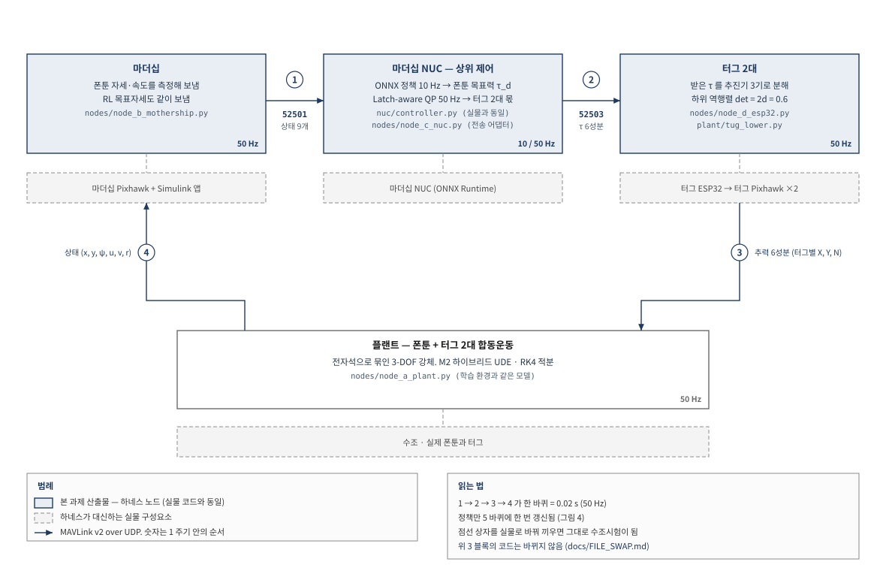
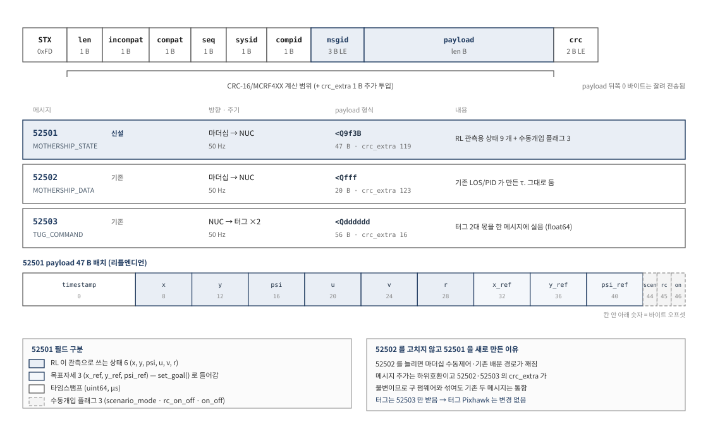
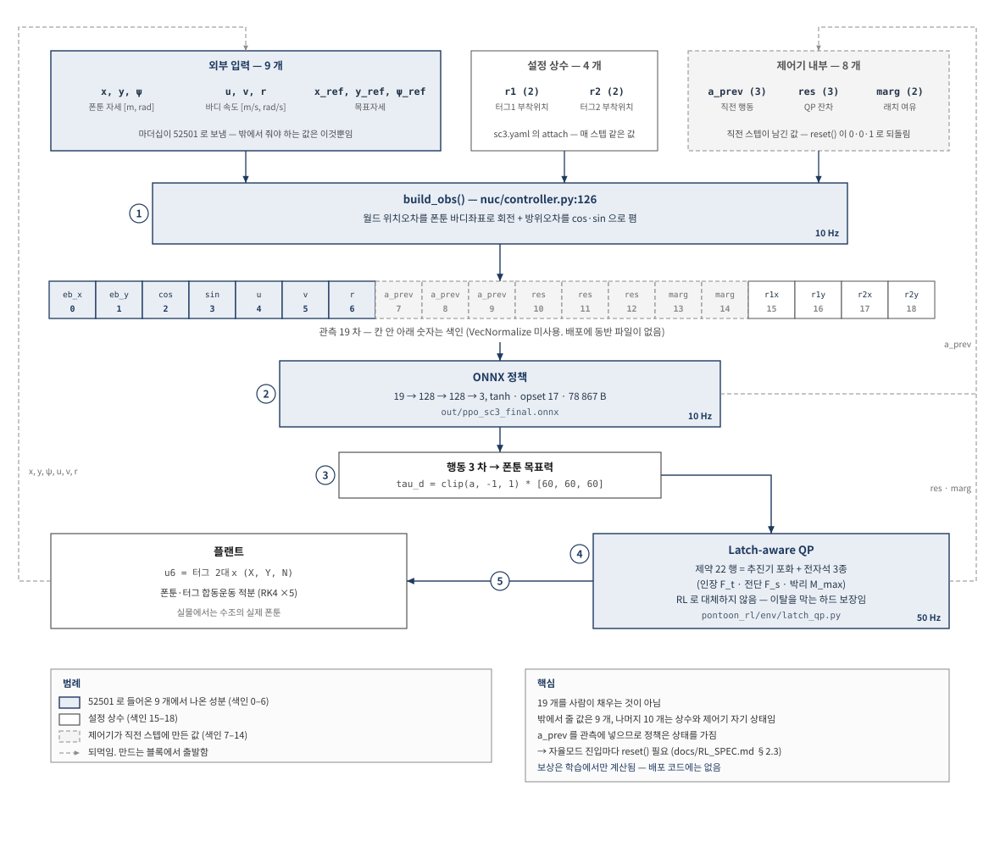
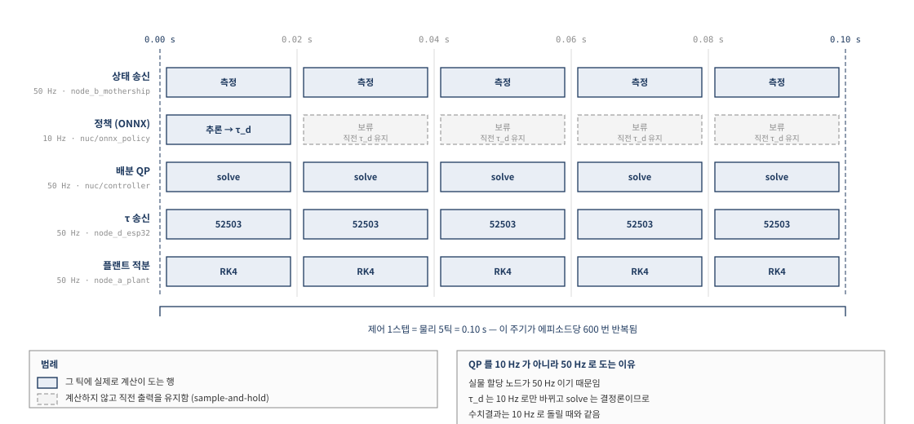
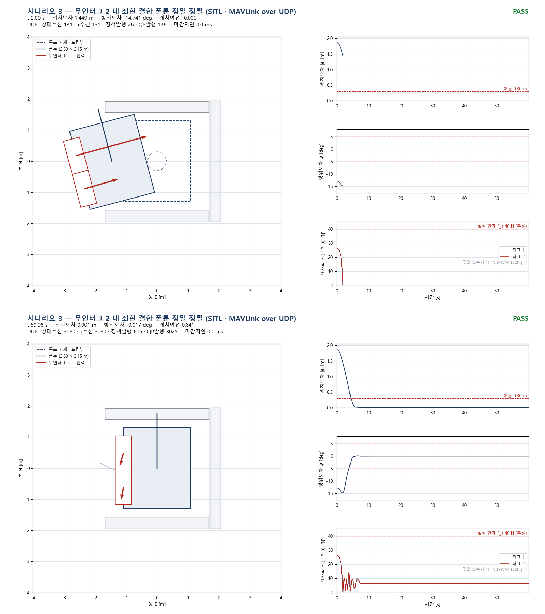

# 폰툰 예인 협조제어 가상 하네스 (마더십 Pixhawk → NUC → 터그 ESP32, MAVLink v2 over UDP)

- 작성: 충남대학교 자율운항시스템공학과 윤원근 교수
- 저장소: <https://github.com/wkyouncnu/pontoon-tug-sitl-harness>
- 매뉴얼(PDF): [docs/manual/harness_sitl.pdf](docs/manual/harness_sitl.pdf). 이 README 와 저장소의 모든 문서를 부록 A–L 로 묶은 단일 파일임
- 라이선스: [MIT](LICENSE). 제3자 구성요소와 제외 파일은 [NOTICE](NOTICE)

## 실행 순서 요약

### 시뮬레이션 — 한 명령으로 전체 재현

```
bash run_all.sh
```

| 순서 | 단계 | 실행 파일 | 합격 판정 | 실측 |
|---|---|---|---|---|
| 1 | `dialect` | `mavlink/gen_dialect.py` | `CRC_EXTRA` 52501 = 119 · 52502 = 123 · 52503 = 16 | 회귀 OK |
| 2 | `onnx` | `policy/export_onnx.py` | sb3 대 ONNX `max|Δ| < 1e-5` | 9.090e-07 |
| 3 | `diagrams` | `docs/img/src/make_diagrams.py` | 그림 4 장 생성 | 4 장 |
| 4 | `tests` | `tests/run_tests.py` | 0 FAIL | 63 PASS / 0 FAIL |
| 5 | `sitl` | `sitl/run_sitl.py --episodes 20 --speed 1 --dr off --seed0 1000` | 20/20 · 평균 ≤ 0.01 m | 20/20 · 0.001 04 m |
| 6 | `manual` | `docs/make_manual.py` | 수식 오류 0 | 102 식 · 오류 0 |

- 한 단계만 돌릴 때는 `bash run_all.sh --only sitl`. 전체 실측 소요 1 246 s
- 실패하면 그 자리에서 중단하고 `out/run_all_<단계>.txt` 꼬리 20 줄을 띄움

### 실물 예인시험 — 측정부터 시작함

| 순서 | 하는 일 | 실행 파일 · 대상 | 통과 기준 |
|---|---|---|---|
| 0 | 마더십 송신 메시지 측정 | `tools/sniff_mothership.py --port 14600 --seconds 30` | 입력 경로 확정 |
| 1 | 부착점 실측 반영 | `config/geometry.yaml` | 머리줄 간격이 실측과 일치 |
| 2 | 다이얼렉트 생성 (NUC) | `mavlink/gen_dialect.py` | `CRC_EXTRA` 123 · 16 불변 |
| 3 | (52501 경로만) 패치 적용 | `patch/0001-add-mothership-state-52501.patch` | `/mothership/state` 생성 |
| 4 | NUC 에 제어 코드 배치 | `nuc/` · `../pontoon_rl/` · `out/ppo_sc3_final.onnx` | import 성공 |
| 5 | 수신 확인 (육상) | 계수기 | `rx_parse_err` 0 · `rl_stale` 0 |
| 6 | 통전 전 안전 점검 | `rc_on_off = 1` | 명령 τ = 0 |
| 7 | 수동 조종 확인 | 마더십 기존 LOS·PID | 터그 2 대 반응 |
| 8 | 자율 전환 | `rc_on_off = 0` | 위치오차 감소 |
| 9 | 종료·기록 | τ=0 ×10 후 소켓 종료 | 로그 회수 |

- 상세 명령·옵션: [docs/RUN_ORDER.md](docs/RUN_ORDER.md)
- 현장 점검표: [docs/FIELD_CHECKLIST.md](docs/FIELD_CHECKLIST.md)
- 디버그 — 계층 분리 · 계수기 해석 · 증상별 조치: [docs/DEBUG.md](docs/DEBUG.md)
- ⚠️ 터그 Pixhawk 에 수신 타임아웃이 없어 **마지막 명령값을 유지함.** 조치 순서는
  조종기 개입 → 자율 해제 → 급전 차단



*그림 1. 시스템 구성*

## 목차

1. [개요](#1-개요)
2. [통신 구조](#2-통신-구조)
3. [제어 구조](#3-제어-구조)
4. [설치](#4-설치)
5. [실행](#5-실행)
6. [파일 교체 경계](#6-파일-교체-경계)
7. [검증](#7-검증)
8. [안전](#8-안전)
9. [실장비 적용](#9-실장비-적용)
10. [확인 필요 사항](#10-확인-필요-사항)

---

## 1. 개요

### 1.1 목적

- 마더십 NUC 에서 동작할 강화학습 정책과 Latch-aware QP 를, 실장비 없이 폐루프로 검증함
- 가상과 실물의 차이를 **전송계층과 플랜트로 한정**함. `nuc/` 의 production 코드는 한 글자도 바꾸지 않고 실물 NUC 으로 옮겨짐
- 마더십 상태를 NUC 으로 전달하는 신설 메시지 `MOTHERSHIP_STATE`(52501)의 적용 전 사전검증을 수행함

### 1.2 주요 사양

| 항목 | 값 |
|---|---|
| 대상 시나리오 | 터그 2대가 폰툰 좌현 변에 전자석으로 부착, 정지 정밀 정렬 (시나리오 3) |
| 제어 대상 | 폰툰 3자유도 (surge, sway, yaw), NED 세계좌표 + FRD 선체좌표 |
| 정책 | ONNX, 관측 19차원 → 128 → 128 → 행동 3차원, tanh, opset 17, 78 867 B |
| 상위 배분 | Latch-aware QP (추력기 포화 + 전자석 3행 제약), 50 Hz |
| 하위 배분 | 터그 Pixhawk 내부 역행렬 `det T = 2d = 0.6`, 하네스는 배포하지 않음 |
| 레이트 | 물리 50 Hz (0.02 s) : 제어 10 Hz (0.10 s) = 5.00 : 1 |
| 에피소드 | 제어 600 스텝 = 물리 3 000 틱 = 60 s |
| 전송 | MAVLink v2 over UDP (상행 52501·52502, 하행 52503) |
| 합격 기준 | 20 에피소드 20/20, 평균 위치오차 0.01 m 이하, 재학습 금지 |
| 실행 환경 | Windows 11, Python 3.8.2 (`plan_pontoon_rl/.venv`), pymavlink 2.4.50 |

### 1.3 외부 인터페이스

| 구분 | 상대 | 방향 | 내용 |
|---|---|---|---|
| 상행 | 마더십 Pixhawk·Simulink → NUC | 수신 | `MOTHERSHIP_STATE`(52501) 자세·속도·목표, `MOTHERSHIP_DATA`(52502) τ |
| 하행 | NUC → 터그 ESP32 ×2 → 터그 Pixhawk | 송신 | `TUG_COMMAND`(52503) 터그 2대분 τ |
| 생존신호 | NUC → 마더십 ESP32 | 송신 | `HEARTBEAT` 1 Hz |

### 1.4 저장소 구성

```
nuc/            production 모듈 (실물 NUC 에 그대로 올라감. 전송계층 import 0)
plant/          터그 하위 역행렬 (배포 대상 아님, 플랜트측 모사)
nodes/          inproc 경로의 얇은 전송 어댑터 (A 플랜트 · B 마더십 · C NUC · D ESP32)
iface/          inproc 전송계층 · 메시지 정의 · 스키마
sitl/           SITL 전용. 플랜트 프로세스 · MAVLink 송수신 · NUC 노드 래퍼 · 플랫폼 대역
shim/           rclpy · tug_interfaces 대역 (실물에서는 실제 ROS 2 로 대체)
vendor/         실험 저장소 노드 사본 (읽기전용. diff 를 증거로 관리)
mavlink/        다이얼렉트 사본 + 52501 신설분 + 생성기
config/         tug_bridge.yaml (실주소) · tug_bridge_loopback.yaml (가상주소)
policy/         sb3 체크포인트 → ONNX 내보내기
tests/          수작업 러너 + 시험 모듈 (pytest 미사용)
docs/           파일교체 경계 · 그림 · 매뉴얼
viz/            궤적 npz → mp4 가시화
patch/          실기체 반영용 패치 (푸시하지 않음)
out/            실행 산출물 (로그 · 합격판정 · 영상)
```

### 1.5 달성 범위 — 되는 것과 안 되는 것

#### 1.5.1 되는 것 (실측으로 확인된 것)

| 항목 | 실측 근거 |
|---|---|
| 전송계층을 끼운 폐루프가 합격기준을 통과함 | SITL 20 에피소드 **20/20**, 평균 위치오차 **0.00104 m**, 방위 **0.0172°**. 기준(20/20 · 0.01 m)의 **10 배 여유** |
| **재학습 없이** 통과함 | `pontoon_rl/out/n1/ppo_sc3_final.zip` 을 그대로 ONNX 로 변환해 사용함 (zero-shot) |
| 전체 재현이 한 번의 명령으로 끝남 | `run_all.sh` 6 단계 **6/6 PASS**, 1 246 s |
| 같은 제어기가 두 경로에서 같은 숫자를 냄 | inproc 어댑터 대 SITL 어댑터, 40 스텝 × 6 성분 τ 차이 **정확히 0** |
| ONNX 가 학습된 정책과 같음 | 2 000 샘플 max abs **9.09e-07** (허용 1.0e-05) |
| 벤더 노드 3 개를 한 줄도 고치지 않음 | `tug_tx.py` · `mav_link.py` · `relay_common.py` **diff 0** (`diff --strip-trailing-cr` 측정) |
| 52501 신설이 기존 경로를 깨지 않음 | 52502·52503 의 `crc_extra` **123·16 불변** (실측). 터그측 변경 **0** |
| 52501 반영 패치가 가산 전용임 | 5 파일 **+118 / −0**. 생성기가 삭제 줄을 검사해 0 이 아니면 실패 반환 |
| 통신 열화 내성 | 왕복 RTT **400 ms** 까지, 손실률 **50 %** 까지 유지 (§7.4) |
| 안전 전이가 실제 전송경로에서 동작함 | τ=0 전이·종료 버스트 **7 항목 PASS**, 와이어에서 τ=0 ×10 수신 확인 |

#### 1.5.2 안 되는 것 · 하지 않은 것

| 항목 | 상태 | 영향 |
|---|---|---|
| 마더십 Simulink 바이패스 탭 | **실패로 종결.** 모델(`mothership_bypass_v1.slx`)은 생성되었으나 **컴파일되지 않음** — `px4:blockmask:InvalidTopicName` 13 건. 모델 마스크값이 CamelCase 이고 이 PC 펌웨어 트리는 snake_case 임 | 하네스 검증에 불필요함. 노드 B(`nodes/node_b_mothership.py`)가 같은 역할을 파이썬으로 수행하므로 **추가 작업을 하지 않음.** 파일은 저장소에서 제외함 |
| `--dr on` (도메인 무작위화) 평가 | **수행하지 않음** | 52501 에 부착점 필드가 없어 공칭값과 참값이 갈라지는 상황이 미평가 상태로 남음 |
| 20 에피소드의 통계적 의미 | 최종 오차가 8 번째 소수자리까지 동일함 | 공통 수렴점에 도달한 결과이므로 **정확도의 독립표본 20 개가 아님** |
| 전송계층까지 포함한 무조건 동일 | 원리적으로 불가능함 | inproc 경로에만 float32 양자화가 있음. 실측 τ_d 차이 1.43e-05 N (상대 2.4e-07) |
| 실장비 시험 | **하지 않음** | 본 하네스는 사전검증까지임. 패치 적용·실기체 반영은 저장소 소유자 조율 사항 (§9.3) |
| ep 19 (seed 1019) 의 `overrun 50` | **원인 미확인** | 20 에피소드 중 1 개에서만 발생(`worst 29.0 ms`). 위치오차는 전 에피소드 동일하므로 제어성능이 아니라 Windows 스케줄링 지터로 판단하나 **확증하지 못함** |
| 전자석 한계값 | **추정치** | 유일한 실측 근거는 PWM 1700 µs 에서의 이탈(≈ 18 N)이며 작용 방향(인장·전단)이 불명임 |
| 폰툰 `I_z` | **불일치 미해소** | `sc3.yaml` 147 kg·m² 대 상시문서 457–914 kg·m², 3–6 배 차이. 하네스는 임의로 고치지 않음 (§10.1) |
| `iface/ros2_stub.py` | **미사용 스텁** | docstring 이 폐기된 uXRCE-DDS 전제를 기술함. 정리 대상 |
| PDF 쪽 넘김 | **육안 확인만** | PyMuPDF 가 없어 쪽별 자동 검사를 하지 못함. HTML 전폭 PNG 로만 확인함 |

### 1.6 파일별 기능

구분 표기는 §6 의 파일 교체 경계와 같은 뜻임.
**P** = production (실물에 그대로 올라감) · **V** = 가상 전용 (실물에서는 삭제·대체) ·
**R** = 실물 NUC 에서 실행되는 ROS 2 노드 · **D** = 벤더(타인 저장소) 사본 ·
**T** = 시험 · **G** = 생성기·도구

#### 1.6.1 제어 — 실물에 올라가는 코드

| 파일 | 줄 | 구분 | 기능 |
|---|---|---|---|
| `nuc/controller.py` | 187 | **P** | 상위 제어기. `build_obs()` 관측 19차 조립 · `policy_step()` 10 Hz 정책호출 · `allocate()` 50 Hz Latch-aware QP · `reset()` · 수동개입 시 τ=0 전이. 전송계층을 import 하지 않음 |
| `nuc/onnx_policy.py` | 69 | **P** | ONNX Runtime 추론기. 19차 입력 → 3차 행동. `τ_d = a ⊙ τ_max` 환산 포함 |
| `nuc/cfg.py` | 161 | **P** | 설정 병합. `sc3.yaml`(학습값) 위에 `config/geometry.yaml`(현장 부착기하)을 덮어씀. 오타·좌표계 변경·mm 단위 입력을 거부 (§3.4) |
| `nuc/px4_state.py` | 264 | **P** | PX4 표준 텔레메트리 → 외부입력 9 개 조립. 쿼터니언 → yaw, NED 속도 → 선체 속도 회전, LLA → 지역 NED, 신선도 판정 (§2.4) |
| `nuc/__init__.py` | 17 | **P** | 패키지 선언. production 경계를 docstring 으로 고정 |
| `sitl/nuc_nodes.py` | 235 | **R** | 실물 NUC 의 ROS 2 노드 그 자체. `/mothership/state` 구독 → 정책 → `/tug_command` 발행. `rl_stale`·`qp_stale`·`rl_override` 계상 |

#### 1.6.2 통신 — 벤더 노드와 다이얼렉트

| 파일 | 줄 | 구분 | 기능 |
|---|---|---|---|
| `vendor/tug_bridge/mothership_rx.py` | 283 | **D** | 마더십 ESP32 의 52502 를 `/mothership/data` 로 발행. 본 과제가 52501 분기와 `/mothership/state` 를 **가산**(+32 / −0) |
| `vendor/tug_bridge/tug_tx.py` | 260 | **D** | `/tug_command` → 52503 인코딩, 터그 ESP32 로 50 Hz 고정주기 송신. 입력단절·NaN·종료 시 τ=0. **diff 0** |
| `vendor/tug_bridge/mav_link.py` | 255 | **D** | UDP 바인드 · 수신·파싱 · 재바인드 백오프 · 고정목적지 송신. **diff 0** |
| `vendor/tug_bridge/relay_common.py` | 207 | **D** | MAVLink 인·디코딩과 종료 시그널 처리의 순수 로직. **diff 0** |
| `mavlink/usv_tug.xml` | — | **G** | 다이얼렉트 정의. 52502·52503 은 실험 저장소 정의, **52501 만 본 과제 신설** |
| `mavlink/gen_dialect.py` · `.sh` | 80 | **G** | 위 XML 로 pymavlink 다이얼렉트를 생성하고 `crc_extra` 119·123·16 을 검사 |
| `mavlink/MothershipState.msg` | — | **G** | 52501 의 ROS 2 메시지 정의 (NUC `tug_interfaces` 용) |
| `mavlink/simulink/MothershipState.msg` | — | **G** | 같은 메시지의 Simulink 측 정의 (필드 순서·형 동일) |
| `config/geometry.yaml` | 65 | — | **현장에서 고치는 파일.** 터그 부착점 `r1`·`r2` 와 불확실도. 머리말에 기준좌표계와 재는 방법이 있음 (§3.4 · `docs/GEOMETRY.md`) |
| `config/tug_bridge.yaml` | — | — | 실주소·포트·레이트. 원작자 `(가정)` 태그 보존 |
| `config/tug_bridge_loopback.yaml` | — | **V** | 같은 구조의 루프백 주소판. SITL 이 사용 |

#### 1.6.3 플랜트와 SITL — 실물에서는 사라지는 코드

| 파일 | 줄 | 구분 | 기능 |
|---|---|---|---|
| `plant/tug_lower.py` | 119 | **V** | 터그 1대의 하위 추력배분. 추진기 3기(후미 2 + 바우 레터럴 1), `det T = 2d = 0.6`, `f ∈ [−28.33, 35.85] N`. **실물에서는 터그 Pixhawk 가 수행** |
| `sitl/plant_proc.py` | 172 | **V** | SITL 외부세계 프로세스. 폰툰·터그 동역학 적분 50 Hz, 52501·52502 송신, 52503 수신, HEARTBEAT 소진 |
| `sitl/px4_state_node.py` | 262 | **R** | PX4 표준 입력경로 노드 2 종. `Px4StdStateNode`(MAVLink UDP, 벤더 `MavUdpLink` 사용) 와 `Px4DdsStateNode`(uXRCE-DDS `/fmu/out/*`, 캡스톤 예제 패턴). 둘 다 `/mothership/state` 를 발행 (§2.4) |
| `sitl/wire.py` | 250 | **V** | 플랜트쪽 MAVLink 송수신. `MothershipTx` 가 `14660` 을 듣기만 하는 소켓으로 열어 §7.6 결함을 차단 |
| `sitl/run_sitl.py` | 347 | **V** | SITL 러너. 두 프로세스 기동·시드·에피소드 경계·합격판정 json 생성 |
| `sitl/bootstrap.py` | 121 | **V** | 벤더 노드를 Windows 에서 돌리기 위한 환경 준비(`SIGHUP` 대역 등). POSIX 에서는 불필요 |

#### 1.6.4 inproc 경로 — 전송계층 없는 단일 프로세스

| 파일 | 줄 | 구분 | 기능 |
|---|---|---|---|
| `run_harness.py` | 249 | **V** | A→B→C→D→A 폐루프 스케줄러. 레이트 분리와 에피소드 경계를 담당 |
| `nodes/node_a_plant.py` | 112 | **V** | 노드 A. `/tug/thrust` 수신 → 적분 → `/plant/state` 발행 (실물 수조 대응) |
| `nodes/node_b_mothership.py` | 75 | **V** | 노드 B. 마더십 Pixhawk 바이패스. 플랜트 상태를 52501 형식으로 중계 |
| `nodes/node_c_nuc.py` | 176 | **V** | 노드 C. NUC 전송 어댑터. **제어 연산을 하지 않고** `nuc/` 를 호출만 함 |
| `nodes/node_d_esp32.py` | 132 | **V** | 노드 D. 터그 링크 어댑터. 52503 을 받아 터그별 τ 선택 후 하위배분 호출 |
| `nodes/topics.py` | 50 | **V** | 토픽 이름 상수 |
| `iface/transport.py` | 139 | **V** | 전송계층 추상화 + inproc 구현. `to_wire()` 가 상태를 float32 로 양자화 (§7.5) |
| `iface/messages.py` | 351 | **V** | 하네스 메시지 dataclass 와 직렬화 |
| `iface/mavlink_wire.py` | 116 | **V** | MAVLink v2 프레이밍 직접 구현 (와이어 왕복 시험용) |
| `iface/schema.yaml` | — | **V** | 메시지 스키마. dataclass 와의 동기를 시험이 고정 |
| `iface/ros2_stub.py` | 163 | — | **미사용 스텁.** docstring 이 폐기된 uXRCE-DDS 전제를 기술함 — 정리 대상 (§10.3) |

#### 1.6.5 ROS 2 대역

| 파일 | 줄 | 구분 | 기능 |
|---|---|---|---|
| `shim/rclpy/__init__.py` | 382 | **V** | `rclpy` 최소 대역. 노드·타이머·퍼블리셔·구독·파라미터·스핀 |
| `shim/rclpy/parameter.py` · `qos.py` · `executors.py` · `node.py` · `signals.py` | 206 | **V** | 벤더 노드가 실제로 쓰는 범위만 대역 |
| `shim/tug_interfaces/msg/__init__.py` | 111 | **V** | ROS 2 메시지 클래스 4종 대역 |

#### 1.6.6 정책 · 시험 · 도구

| 파일 | 줄 | 구분 | 기능 |
|---|---|---|---|
| `policy/export_onnx.py` | 153 | **G** | sb3 PPO 체크포인트 → ONNX 내보내기 + 2 000 샘플 수치일치 검증 |
| `policy/onnx_policy.py` | 32 | — | `nuc/onnx_policy.py` 의 re-export 껍데기 (하위호환) |
| `tests/run_tests.py` | 117 | **T** | 자체 러너. pytest 없이 전 모듈 수집·실행 |
| `tests/test_acceptance.py` | 119 | **T** | inproc 폐루프 20 에피소드 합격판정 |
| `tests/test_sitl_parity.py` | 276 | **T** | 같은 제어기, 다른 어댑터, 같은 숫자 — τ 차이 0 |
| `tests/test_same_code_both_paths.py` | 228 | **T** | 학습 환경 `_obs()` 와 배포 `build_obs()` 의 동일성 고정 |
| `tests/test_onnx_parity.py` | 174 | **T** | ONNX ↔ sb3 수치 일치 (2 000 샘플 · 온매니폴드 롤아웃) |
| `tests/test_safety.py` | 423 | **T** | τ=0 전이·종료 버스트 7 항목. **실제 전송경로**로 시험 |
| `tests/test_wire_roundtrip.py` | 239 | **T** | 52501 13 필드 왕복·뒤쪽 0 복원·`crc_extra` 고정 |
| `tests/test_schema_sync.py` | 109 | **T** | 스키마 ↔ dataclass 동기 |
| `tests/test_px4_state.py` | 238 | **T** | PX4 표준 입력경로 9 항. 쿼터니언·속도회전·LLA 변환·신선도·비유한값 거부 |
| `tests/test_geometry_cfg.py` | 173 | **T** | 부착기하 외부화 9 항. 덮어쓰기가 제어기·QP·플랜트에 **모두** 닿는지 고정 |
| `tools/sniff_mothership.py` | 141 | **G** | 마더십이 어떤 MAVLink 메시지를 실제로 내보내는지 읽기전용 청취. 표준경로 사용가능 여부를 30 초에 판정 |
| `tools_sweep_comm.py` | 144 | **G** | 통신 열화(지연·손실) 스윕 → §7.4 포락선 |
| `viz/make_video_sitl.py` | 245 | **G** | SITL 궤적 npz → mp4 가시화 (§7.7) |
| `docs/obs_howto.py` | 81 | **G** | 관측 19차를 무엇으로부터 만드는지 보이는 실행 예제 |
| `docs/make_manual.py` | — | **G** | README + 부록 → 단일 A4 PDF (KaTeX 수식 렌더) |
| `docs/img/src/make_diagrams.py` | 599 | **G** | 보고서용 SVG 그림 4장 생성 (외부 라이브러리 없음) |
| `patch/make_patch.py` | 177 | **G** | 52501 반영 패치 생성기. 삭제 줄이 1 줄이라도 생기면 실패 반환 |
| `_console.py` | 17 | **G** | cp949 콘솔에서 한글·기호 출력 보호 |
| `run_all.ps1` · `run_all.sh` | — | **G** | 6 단계 전체 재현 (`dialect → onnx → diagrams → tests → sitl → manual`) |

---

## 2. 통신 구조



*그림 2. MAVLink v2 프레임과 메시지 3종*

### 2.1 다이얼렉트

| 메시지 | id | 포맷 | payload | frame | `crc_extra` |
|---|---|---|---|---|---|
| `MOTHERSHIP_STATE` | 52501 (신설) | `<QfffffffffBBB` | 47 B | 59 B | 119 |
| `MOTHERSHIP_DATA` | 52502 | `<Qfff` | 20 B | 32 B | 123 |
| `TUG_COMMAND` | 52503 | `<Qdddddd` | 56 B | 68 B | 16 |

- 52501 필드순서: `timestamp, x, y, psi, u, v, r, x_ref, y_ref, psi_ref, scenario_mode, rc_on_off, on_off`
- 선언 필드순서가 MAVLink 의 크기 내림차순 와이어순서와 일치함. 재배치 없이 `MothershipState.msg` 와 1:1 대응함
- payload 뒤쪽 0 바이트는 잘려 전송되고 수신측이 복원함. 52501 전부 0 인 경우 24 B, 전필드 유효 시 59 B 로 측정됨
- 52502·52503 의 `crc_extra` 가 메시지 추가 후에도 123·16 으로 불변임을 측정으로 확인함. 다이얼렉트 `<version>` 을 올리지 않는 근거임

### 2.2 주소 · 레이트

| 항목 | 값 |
|---|---|
| 식별자 | NUC `sysid 250` / `compid 191`, 마더십 1, 터그 2·3, `TUG_ACCEPTED_SYSID 250` |
| NUC bind | `14600` 마더십 수신, `14601` 터그1 송신, `14602` 터그2 송신, `14660` HEARTBEAT 수신 |
| 실물 ESP32 | `192.168.68.201/.202/.203`, 원격 포트는 항상 `14550` (DroneBridge 고정) |
| 루프백 | `14601 → 127.0.0.1:14651`, `14602 → 127.0.0.1:14652` |
| 송신 | `send_rate_hz 50.0`, `input_timeout_s 0.5`, HB 1 Hz / `heartbeat_timeout_s 3.0` |
| 수신 | `filter_sysid 1`, `filter_compid 0` (compid 1 의 52501 통과), `rx_timeout_s 1.0`, `rebind_after_s 5.0` |
| 종료 | `shutdown_zero_count 10` |
| QoS | `best_effort` |

- 52501 과 52502 는 **같은 sysid 1 / compid 1 / 같은 포트 14600** 으로 들어옴. 파서와 `allowed_src_ip` 설정이 하나로 유지됨
- `config/*.yaml` 의 `*_s` · `*_hz` 는 `float` 로 기재해야 노드가 기동함. `50` 은 `Parameter.Type.DOUBLE` 위반으로 기동 실패함

### 2.3 토픽

| 토픽 | 타입 | 발행 → 구독 | 주기 | 내용 |
|---|---|---|---|---|
| `/mothership/state` | `MothershipState` | `mothership_rx` → 정책 | 50 Hz | 52501 복원분 |
| `/mothership_data` | `MothershipData` | 정책 → QP | 10 Hz | 정책 출력 τ_d |
| `/tug_command` | `TugCommand` | QP → `tug_tx` ×2 | 50 Hz | 터그 2대분 τ |
| `/allocation_debug` | `TugCommand` | QP → 기록 | 50 Hz | 잔차·여유 기록용 |
| `/pontoon/state` | `PontoonState` | 플랜트 → 마더십 | 50 Hz | inproc 내부 전용 |
| `/tug/thrust` | `TugThrust` | 하위배분 → 플랜트 | 50 Hz | inproc 내부 전용 |

---

### 2.4 입력 경로

- 외부입력 9 개(`x, y, ψ, u, v, r, x_ref, y_ref, ψ_ref`)를 받는 방법이 **2 가지** 있음
- 둘 다 `/mothership/state` 를 발행하므로 **제어기 이하는 완전히 동일**함

| 항목 | 52501 경로 | PX4 표준 경로 |
|---|---|---|
| 메시지 | `MOTHERSHIP_STATE` (52501, 신설) | `ATTITUDE` · `LOCAL_POSITION_NED` · `POSITION_TARGET_LOCAL_NED` |
| 다이얼렉트 변경 | 필요 (`patch/` 의 +118 / −0) | **불필요** — 기존 다이얼렉트에 이미 있음 |
| 마더십 Simulink 변경 | 필요 (52501 송신 블록 추가) | **불필요** |
| 벤더 노드 변경 | `mothership_rx.py` 가산 +32 | **불필요** (별도 노드 추가) |
| 저장소 소유자 조율 | 필요 | 불필요 |
| 필드 정밀도 | `float32` 설계값 그대로 | PX4 가 정한 형 (`ATTITUDE` float, `GLOBAL_POSITION_INT` 1e-7 deg) |
| 구현 | `vendor/tug_bridge/mothership_rx.py` | `sitl/px4_state_node.py` |

#### 2.4.1 표준 메시지 → 외부입력 대응

| 외부입력 | 출처 | 변환 |
|---|---|---|
| `ψ` | `ATTITUDE.yaw` | 없음 (`ATTITUDE_QUATERNION` 사용 시 쿼터니언 → yaw) |
| `r` | `ATTITUDE.yawspeed` | 없음 |
| `x`, `y` | `LOCAL_POSITION_NED.x, .y` | 없음. `GLOBAL_POSITION_INT` 만 올 때는 LLA → 지역 NED |
| `u`, `v` | `LOCAL_POSITION_NED.vx, .vy` | NED → 선체 2×2 회전 |
| `x_ref`, `y_ref`, `ψ_ref` | `POSITION_TARGET_LOCAL_NED.x, .y, .yaw` | 없음 |

- 캡스톤 UGV 예제(uXRCE-DDS)가 비워 둔 2 가지를 메움: **요각속도** 와 **목표 방위**
- 캡스톤 예제는 `/fmu/out/*` (uXRCE-DDS) 를 쓰고 본 과제 체인은 **MAVLink over UDP** 임.
  상태 수신·좌표변환 패턴만 차용하고 전송계층은 기존 벤더 코드를 그대로 씀
- 상세: `docs/INPUT_PATHS.md`

---

## 3. 제어 구조



*그림 3. 관측 19차 조립 · 정책 · 추력배분 QP*

### 3.1 관측 19차원

| 색인 | 블록 | 차원 | 내용 | 출처 |
|---|---|---|---|---|
| 0–1 | `eb` | 2 | 선체좌표 위치오차 | 52501 의 `x, y, ψ` + `x_ref, y_ref` 로 계산 |
| 2–3 | `cos/sin ey` | 2 | 방위오차 | 52501 의 `ψ` + `ψ_ref` 로 계산 |
| 4–6 | `nu` | 3 | `u, v, r` | 52501 그대로 |
| 7–9 | `a_prev` | 3 | 직전 행동 | 제어기 내부 (직전 정책 출력) |
| 10–12 | `res/tau_max` | 3 | QP 잔차 | 제어기 내부 (직전 QP 출력) |
| 13–14 | `marg` | 2 | 래치 여유 | 제어기 내부 (직전 QP 출력) |
| 15–18 | `r1`, `r2` | 2 + 2 | 터그 부착위치 | 설정 상수 (`config/geometry.yaml`, §3.4) |

- 밖에서 공급해야 하는 수는 **9 개**(`x, y, ψ, u, v, r` + `x_ref, y_ref, ψ_ref`)임.
  나머지 10 개는 설정 상수와 제어기 자기 상태이므로 사용자가 만들지 않음
- 조립은 `nuc/controller.py::build_obs()` 가 수행함. 실행 예제는 `docs/obs_howto.py`,
  상세 설명은 `docs/RL_SPEC.md` §2.3
- `VecNormalize` 미사용. 정규화 상수가 없으므로 배포 시 동반 파일이 없음
- `a_prev` 를 관측에 포함하므로 정책은 상태를 가짐. 자율모드 진입마다 `reset()` 이 필요함
- 정책은 행동 3차원(폰툰 τ_d)만 출력함. 터그 6성분 분배는 QP 가 담당함

### 3.2 역할 분담

| 계층 | 담당 | 강화학습 대체 여부 |
|---|---|---|
| 상위 정책 | 폰툰 목표 τ_d 결정 | 대체함 |
| Latch-aware QP | 추력기 포화 · 전자석 인장·전단·박리 3행 제약 | 대체하지 않음 |
| 터그 하위 역행렬 | τ → 추력기 2기 (`det T = 0.6`) | 대체하지 않음 |

- 전자석 이탈을 막는 하드 보장이 QP 에만 있으므로 QP 를 환경 안에 유지함
- 하위 역행렬은 수학적으로 정확한 역행렬이므로 근사로 바꾸지 않음

### 3.3 틱 스케줄



*그림 4. 물리 50 Hz 와 제어 10 Hz 의 분리*

- 제어 1 스텝 = 물리 5 틱. 정책 미갱신 구간은 sample-and-hold 로 동작함
- QP 는 50 Hz 로 동작하므로 정책 출력이 유지되는 구간에도 제약을 매 틱 적용함

---

### 3.4 부착 기하 설정

- 터그 부착점 `r1`·`r2` 는 현장에서 바뀌므로 **`config/geometry.yaml` 한 파일**로 분리함
- 학습 설정 `pontoon_rl/params/sc3.yaml` 은 읽기전용으로 두고, 그 위에 덮어씀
  (`nuc/cfg.py::load_cfg()`). 덮어쓰기 파일이 없으면 학습값을 그대로 씀

| 항목 | 정의 |
|---|---|
| 원점 | 폰툰 **기하중심** (2.60 × 2.15 m 판의 가운데) |
| `+x` | 선수 (bow) |
| `+y` | **우현** (starboard) → 좌현은 음수 |
| 규약 | FRD. 와이어 부호규약 · Fossen 3-DOF 와 동일 |
| 가리키는 점 | 터그 **선체 원점**. 전자석 패드 접촉면이 아님 |
| 단위 · 유효자리 | m · 소수 2 자리 |

- 기본값 `r1 = (+0.4894, −1.08)` · `r2 = (−0.6106, −1.08)`. 두 터그가 같은 **좌현 변**에
  1.10 m 간격(= 터그 전장)으로 붙은 배치임
- 한 군데서 병합하므로 **제어기 · QP · 플랜트 · 관측이 같은 기하**를 씀.
  제어기만 바뀌면 시험이 거짓양성이 되므로 `tests/test_geometry_cfg.py` 가 플랜트까지 고정함
- 오타(`attatch`·`r3`) · 좌표계 변경(`frame`) · mm 단위 입력(`[489.4, −1080]`) · 길이 1·3 벡터 ·
  `NaN` 은 **거부**함. 조용히 무시하지 않음
- `--geometry off` 로 학습 당시 값 재현, `--geometry <경로>` 로 다른 파일 사용
- SITL 머리줄과 결과 json 에 사용한 기하가 기록됨
- 재는 방법 · 확인 필요 사항: `docs/GEOMETRY.md`

---

## 4. 설치

### 4.1 요구 사항

| 항목 | 값 |
|---|---|
| 인터프리터 | `plan_pontoon_rl/.venv/Scripts/python.exe` (Python 3.8.2) |
| 수치 | `numpy`, `quadprog` |
| 추론 | `onnxruntime` |
| 통신 | `pymavlink 2.4.50` (`fastcrc 0.5.0`, `lxml 6.1.3` 동반) |
| 시험 | 없음. `tests/run_tests.py` 수작업 러너 사용 |

### 4.2 명령

```powershell
..\plan_pontoon_rl\.venv\Scripts\python.exe mavlink\gen_dialect.py
```

```powershell
..\plan_pontoon_rl\.venv\Scripts\python.exe policy\export_onnx.py
```

| 단계 | 산출물 | 확인 |
|---|---|---|
| 다이얼렉트 생성 | `mavlink/gen/usv_tug.py` | `crc_extra` 119 · 123 · 16 |
| 정책 내보내기 | `out/ppo_sc3_final.onnx` | 78 867 B, opset 17 |
| 그림 생성 | `docs/img/*.svg` | 4 장 |

- 콘솔 코드페이지가 cp949 이므로 한글 출력에는 `_console.py::utf8_stdout()` 가 필요함

---

## 5. 실행

### 5.1 inproc 폐루프 (단일 프로세스)

```powershell
..\plan_pontoon_rl\.venv\Scripts\python.exe tests\run_tests.py --only acceptance
```

### 5.2 SITL (플랜트와 NUC 분리, MAVLink over UDP)

```powershell
..\plan_pontoon_rl\.venv\Scripts\python.exe sitl\run_sitl.py --episodes 20 --speed 1 --dr off --seed0 1000
```

| 옵션 | 기본 | 내용 |
|---|---|---|
| `--episodes` | 20 | 에피소드 수 |
| `--speed` | 1 | 플랜트 벽시계 배속 |
| `--dr` | `off` | 도메인 랜덤화 |
| `--seed0` | 1000 | 첫 에피소드 시드 |
| `--steps` | 0 | 에피소드당 제어 스텝. 0 은 환경 기본값(600) 사용 |

- `--speed > 1` 은 지연만 바꾸지 않고 제어주기를 바꿈. 플랜트 벽시계만 압축되고 NUC 타이머는 실벽시계이므로 제어기가 굶음. 실측 `--speed 8` 에서 `ctl_policy 5/40`, `dpos 0.927 m`
- 성능 판정은 `--speed 1` 에서만 유효함. `summary["pass"]` 가 `speed == 1.0` 을 강제함

### 5.3 종료

- `Ctrl+C` 로 종료 시 τ=0 을 10 회 송신한 뒤 소켓을 닫음
- SITL 경로의 설계 근거는 [docs/SITL.md](docs/SITL.md) 에 기재함

---

## 6. 파일 교체 경계

### 6.1 가상 전용과 production 의 구분

| 파일 | 구분 | 실물 전환 |
|---|---|---|
| `nuc/controller.py`, `nuc/onnx_policy.py` | production | 수정 없음 |
| `vendor/tug_bridge/tug_tx.py`, `mav_link.py`, `relay_common.py` | 실험 저장소 원본 | 수정 없음 |
| `vendor/tug_bridge/mothership_rx.py` | 실험 저장소 + 가산 | 52501 분기 추가분만 반영 |
| `shim/rclpy`, `shim/tug_interfaces` | 대역 | 실제 ROS 2 · `tug_interfaces` 로 교체 |
| `sitl/plant_proc.py`, `sitl/wire.py` | 가상 전용 | 실물 장비로 교체 (삭제) |
| `sitl/bootstrap.py` | 가상 전용 | 삭제 (POSIX 환경에서는 불필요) |
| `nodes/*`, `iface/*` | inproc 경로 | 사용하지 않음 |

- 상세 경계는 [docs/FILE_SWAP.md](docs/FILE_SWAP.md) 에 기재함

### 6.2 벤더 코드 diff

`test -f` 로 양쪽 입력의 존재를 먼저 확인한 뒤 `diff --strip-trailing-cr` 로 측정함.

| 파일 | diff | 의미 |
|---|---|---|
| `tug_tx.py` | **0** | 터그 송신 경로 무변경 |
| `mav_link.py` | **0** | UDP 링크 · seq 보정 무변경 |
| `relay_common.py` | **0** | 안전·종료 로직 무변경 |
| `mothership_rx.py` | **+32 / −0** | 52501 분기와 `/mothership/state` 퍼블리셔 가산만 |

- `tug_tx.py` 가 0 이고 터그는 52503 만 수신하므로 **터그 Pixhawk · 터그 Simulink · 터그 다이얼렉트는 전혀 바뀌지 않음**
- 52502 경로는 한 줄도 변경하지 않음. 마더십 수동제어와 기존 LOS/PID 배분 경로가 유지됨
- 같은 포트로 두 메시지가 들어오므로 `mothership_rx.py` 의 가산 diff 는 불가피함. 기존 `[stats]` 줄을 보존하기 위해 카운터를 신설함(`state_total`, `last_state_mono`)

---

## 7. 검증

### 7.1 검증 항목

| 구분 | 실행 | 대상 | 기준 |
|---|---|---|---|
| 단위 | `tests/run_tests.py` | 다이얼렉트 · 메시지 · 레이트 · 하위배분 | 전 항목 PASS |
| 동일코드 | `tests/test_sitl_parity.py` | inproc 어댑터 대 SITL 어댑터 | τ 차이 0 |
| 안전 | `tests/test_safety.py` | τ=0 전이 · 종료 버스트 | 7 항목 PASS |
| 합격 | `tests/run_tests.py --only acceptance` | inproc 폐루프 20 에피소드 | 20/20, 평균 0.01 m 이하 |
| 합격 | `sitl/run_sitl.py` | SITL 폐루프 20 에피소드 | 20/20, 평균 0.01 m 이하 |

### 7.2 시험 결과

| 시험 | 결과 |
|---|---|
| 전체 묶음 | **45 PASS / 0 FAIL** |
| SITL 폐루프 20 에피소드 | **20/20**, 평균 **0.00104 m** (최대 0.00104), 방위 0.0172°, overrun 0 → **PASS** |
| inproc 폐루프 20 에피소드 | **20/20**, 평균 0.00252 m (최대 0.00517), 방위 0.0296° → **PASS** |
| 두 어댑터 τ 일치 | 40 스텝 × 6 성분, τ_d · τ_i 차이 **정확히 0** (`|τ_i|max 35.85 N`) |
| `a_prev` 전개 일치 | 12 스텝, 차이 **정확히 0** |
| ONNX 대 sb3 (2 000 샘플) | max abs 9.090e-07 / mean 3.618e-08 (허용 1.0e-05) |
| ONNX 온매니폴드 롤아웃 (n=2 404) | max abs 6.557e-07 / mean 8.232e-08 |
| 하위 역행렬 왕복 | 오차 1.8e-15 |
| 레이트 분리 | 5.00 : 1 |
| 와이어 왕복 | 52501 13 필드 왕복 · 뒤쪽 0 복원 · `crc_extra` 3 종 고정 |

### 7.3 SITL 계상기 (20 에피소드 누계)

| 계상기 | 값 | 의미 |
|---|---|---|
| `rx_pkt` | 122 409 | NUC 수신 데이터그램 |
| `rx_reopen` | **0** | 소켓 재바인드 없음 |
| `tx_state` / `rx_state` | 60 600 / **60 600** | 상행 손실 **0 %** |
| `rx_parse_err`, `rx_drop_sysid`, `tx_err` | 0 | 프레이밍·필터·송신 오류 없음 |
| `rl_stale`, `qp_stale` | 0 | 상태 노후화로 인한 송신중단 없음 |
| `rl_override` | 122 | 에피소드 경계의 `on_off=0` 경로가 실제로 동작함 |
| `n_sat` | **0** | 터그 하위배분 미포화 |
| `worst_lag_ms` | 16–17 | Windows `time.sleep` 분해능(약 15.6 ms) 수준 |

### 7.4 통신 열화 포락선

| 항목 | 한계 |
|---|---|
| 상행 지연 | 10 틱 (200 ms) |
| 하행 지연 | 5 틱 (100 ms) |
| 손실률 | 50 % |
| 붕괴 지점 | 왕복 RTT 400 ms |

- 상행 IAE 와 하행 IAE 가 8.35 로 동일함. 지연 예산은 편측이 아니라 **RTT 로 기술해야 함**

### 7.5 검증의 한계

| 항목 | 증명된 것 | 증명되지 않은 것 |
|---|---|---|
| inproc 상태 양자화 | 어댑터 코드의 τ 차이 0 | inproc 경로는 `iface/transport.py:94` 의 `to_wire()` 로 상태를 float32 로 양자화함. SITL 경로에는 그 양자화가 없으므로 전송계층까지 포함한 무조건 동일은 원리적으로 불가능함. 실측 τ_d 차이 1.43e-05 N (`|τ_d|max 60.0 N`, 상대 2.4e-07). inproc 하네스는 실물보다 나쁜 입력으로 동작하므로 그 합격 판정은 보수적임 |
| 종료 시그널 | τ=0 ×10 송신 로직 (와이어에서 10 개 수신 확인) | SSH 단절(SIGHUP)이 그 로직을 실제로 깨우는가. Windows 에 `SIGHUP` 이 없어 `sitl/bootstrap.py` 가 대역함. **전송계층·플랜트에 이은 세 번째 가상·실물 차이임** |
| 부착위치 `r1`, `r2` | 관측에 들어가는 값이 설정의 공칭값임 | 52501 에 부착점 필드가 없으므로 실물에서도 공칭값을 사용함. 실제 부착위치와의 차이는 관측 오차로 남음 |
| 배속 실행 | `--speed 1` 의 성능 | `--speed > 1` 은 제어주기를 바꾸므로 성능 판정에 사용할 수 없음 |
| 20 에피소드의 의미 | 서로 다른 초기자세 20 개에서 전부 수렴함 (`init_pos ±3.0 m`, `init_yaw ±0.52 rad`) | 최종 오차가 8 번째 소수자리까지 동일함. 공통 수렴점에 도달한 결과이므로 **20 개 수치는 정확도의 독립표본 20 개가 아님** |

### 7.6 하네스 충실도 결함 사례

- 증상: SITL 상행 `52501/52502` 가 약 50 % 소실됨. 송신율과 무관하며 `parse_errors` · `drop_msgid` · `drop_sysid` · `dropped_ip` 가 전부 0 이어서 계상기가 원인을 가림
- 원인: `heartbeat_target_port 14660` 을 하네스에서 아무도 듣지 않음. NUC 의 1 Hz HEARTBEAT 가 죽은 포트로 가면 ICMP port-unreachable 이 돌아오고, Windows 는 이를 같은 UDP 소켓의 `recvfrom` 에 `WSAECONNRESET`(10054) 로 올림. 벤더 `MavUdpLink` 가 이를 비일시 오류로 보아 소켓을 닫고 재바인드하며, 닫힌 구간에 도착한 데이터그램이 소실됨
- 조치: `sitl/wire.py::MothershipTx` 가 `14660` 을 듣기만 하는 소켓으로 열고 `plant_proc.tick()` 이 `drain_hb()` 로 비움. 실물에 실제로 존재하는 마더십 ESP32 를 모사한 것이며 **벤더 diff 0 을 유지함**
- 전후 비교: `rx_pkt 561/1071 → 1071/1071`, `rx_reopen 10 → 0`, 손실 50 % → 0 %, 1 에피소드 `dpos 0.0156 → 0.00081 m`
- 교훈: 하네스 충실도 결함이 플랜트 성능저하로 위장함. 벤더 결함이 아니었음

### 7.7 가시화 영상

- 대상: SITL 1 에피소드(seed 1000). `sitl/run_sitl.py --traj out/traj_sitl.npz` 가 기록한 궤적을 `viz/make_video_sitl.py` 가 mp4 로 렌더함
- 산출물: [out/sitl_sc3.mp4](out/sitl_sc3.mp4) — 25 fps · 1501 프레임 · 60 s 실시간 · 4.60 MB
- 재현: `python viz\make_video_sitl.py` (정지화면만 필요하면 `--stills 2.0,60.0`)

| 영역 | 표시 내용 |
| --- | --- |
| 좌측 장면 | 폰툰(2.60 × 2.15 m) · 무인터그 2 대 · 터그별 합력 벡터 · 목표 자세(파선) · 허용원 0.30 m · ㄷ 형 도킹부 · 중심 궤적 |
| 우측 1 | 위치오차 ‖e_p‖ 와 허용 0.30 m |
| 우측 2 | 방위오차 e_ψ 와 허용 ±5° |
| 우측 3 | 터그별 전자석 전단력 \|X\|, 설정 한계 40 N(파선)과 유일한 실측치 18 N(점선) |
| 상단 HUD | 시각 · 위치오차 · 방위오차 · 래치 여유 최소 · UDP 계상기 4 종 · 마감지연 |



*그림 5. 가시화 영상 정지화면 (위 t = 2.0 s · 아래 t = 59.98 s)*

- 영상에서 확인되는 사항
  - 수렴: 위치오차가 약 5 s 에 허용 0.30 m 를 통과하고 약 8 s 이후 0.001 m 수준에서 평탄함. 방위오차는 초기 −14° 에서 약 6 s 에 0° 로 들어옴
  - 최종값: `위치오차 0.001 m · 방위오차 −0.017 deg · 래치여유 0.841 · 마감지연 0.0 ms`
  - 전단력: 과도구간(0–3 s) 최대 약 26 N, 정상구간 약 6 N. 설정 한계 40 N 아래이나 **유일한 실측치 18 N 은 과도구간에서 초과함** → 초기 수렴구간이 전자석 한계의 임계구간임. 한계를 낮추면 QP 가 그만큼 제한하며, 별도 스윕에서 `F_s` 8 N 까지는 20/20 이 유지됨(`pontoon_rl/out/n1/SWEEP_LATCH.md`). 세 한계값은 전부 추정치임 (§10.1)
  - 계상기: 상태수신 3030 · τ수신 3030 · 정책발행 606 · QP발행 3025 로 50 Hz / 10 Hz 분리가 와이어에서 유지됨
- 한계
  - 1 에피소드만 렌더함. 합격판정 20/20 은 §7.2 의 집계값이며 영상이 그 근거는 아님
  - 장면은 평면 개념도이며 유체·접촉 렌더가 아님. 도킹부는 목표 자세를 보이기 위한 개념 형상임
  - PDF 에는 영상을 넣을 수 없어 정지화면 2 장만 수록함

---

## 8. 안전

### 8.1 τ=0 송신 조건

| 조건 | 판정 | 동작 |
|---|---|---|
| 입력 단절 | `input_timeout_s 0.5` 경과 | τ=0 송신 |
| 비유한값 | 6 필드 중 하나라도 NaN·inf | **메시지 전체**를 τ=0 으로 교체 |
| 수동개입 | `rc_on_off != 0` 또는 `on_off == 0` | 정책 출력 무시, τ=0, `a_prev` 초기화 |
| 종료 | SIGINT · SIGTERM · SIGHUP | τ=0 을 10 회 송신 |

### 8.2 안전 설계의 전제

- 터그 Pixhawk 에는 **수신 타임아웃이 없어 마지막 값을 유지함**. `tug_tx` 의 τ=0 송신이 현재 유일한 안전장치임
- **Wi-Fi 가 끊기면 τ=0 조차 도착하지 못함**. 이 경우의 보호 수단은 하네스 범위 밖임
- 종료 시그널이 중복 도착해도 버스트가 끊기지 않음. `relay_common.install_shutdown_signal_handlers()` 의 핸들러가 세 시그널을 `SIG_IGN` 으로 바꾼 뒤 `KeyboardInterrupt` 를 발생시킴
- 에피소드 경계 초기화에 production 경로(`on_off = 0`)를 사용함. 하네스가 `a_prev` 를 직접 건드리지 않으므로 동일코드 주장이 유지되고, 매 에피소드마다 수동개입 경로가 함께 시험됨
- 전자석 한계의 임계는 **전단 `F_s` 8 N** 이며 박리 `M_max` 가 아님. 터그 2대가 같은 변에 1.1 m 간격으로 부착되어 yaw 모멘트 수요가 두 터그 전단력의 차로 전가됨

---

## 9. 실장비 적용

### 9.1 변경 범위

| 대상 | 변경 |
|---|---|
| 마더십 Simulink | `MOTHERSHIP_STATE`(52501) 송신 블록 추가 |
| 마더십 ESP32 | 신설 메시지 중계 (DroneBridge 설정 변경 없음) |
| NUC `mothership_rx.py` | 52501 분기 + `/mothership/state` 퍼블리셔 (+32 / −0) |
| NUC 정책·QP 노드 | 신규 추가 |
| 다이얼렉트 | 52501 블록 추가. `<version>` 불변 |
| **터그 ESP32 · 터그 Pixhawk · 터그 Simulink** | **없음** |

### 9.2 적용 순서

1. 다이얼렉트에 52501 블록 추가 후 `mavlink/gen_dialect.sh` 로 재생성
2. 52502·52503 의 `crc_extra` 가 123·16 으로 불변임을 확인
3. `mothership_rx.py` 에 패치 적용
4. 마더십 Simulink 에서 52501 송신 확인 (수신측 `state_total` 증가로 판정)
5. 정책·QP 노드 기동, `rl_stale` 0 확인
6. 수동개입(`rc_on_off = 1`)으로 τ=0 전이 확인 후 자율 전환

### 9.3 조율 사항

- 실험 저장소(`JiwoongHa/cooperative-tug-experiment`)는 타인 소유임. 본 하네스는 **패치 파일과 diff 설명만 산출하며 푸시하지 않음**
- 패치는 [patch/](patch/) 에 보관함
- 다이얼렉트 `<version>` 을 올리지 않는 근거는 메시지 추가가 하위호환이고 기존 두 메시지의 `CRC_EXTRA` 가 불변이라는 측정 결과임. 추가 사실은 README 와 changelog 에만 기재함

---

## 10. 확인 필요 사항

### 10.1 미확인 항목

| 항목 | 현재 설정 | 확인 대상 |
|---|---|---|
| 폰툰 `I_z` | `sc3.yaml` 147 kg·m² 사용 | 상시 문서의 457–914 kg·m² 와 3–6 배 불일치. 동일 물체를 가리키는지 확인 필요. 하네스는 임의로 고치지 않음 |
| `psi_time_log` 단위 | rad 로 가정 | 마더십 Simulink 에서 rad 인지 deg 인지 |
| `rc_on_off` · `on_off` 의미 | 0 이 아니면 수동개입으로 처리 | Simulink 측 정의 (해당 신호는 `float32`) |
| `x_ref` · `y_ref` | 절대 좌표로 사용 | 절대인지 상대인지 |
| 터그 Pixhawk 구성 | 미확인 | Simulink 생성 앱인지 PX4 순정 모듈인지 |
| `tug_bridge.yaml` 가정값 | 원작자 `(가정)` 태그 유지 | 태그가 붙은 값 전부 |
| PWM 대 추력 곡선 | 미측정 | 전자석 한계 실측치의 작용 방향(인장·전단) 포함 |
| 전자석 한계 | 추정값 사용 | 유일한 실측치는 PWM 1700 µs 에서의 이탈 |

### 10.2 종결된 항목

| 항목 | 결과 |
|---|---|
| 마더십 Simulink 바이패스 탭 | **실패로 종결.** 모델 열기·구조 열거는 가능하나 컴파일 불가(`px4:blockmask:InvalidTopicName` 13 건). 모델 마스크값이 CamelCase 이고 이 PC 펌웨어 트리는 snake_case 임. 해소책은 본 과제 범위 밖 |
| 라이선스 | Embedded Coder · Simulink Coder · MATLAB Coder · Deep Learning Toolbox · Reinforcement Learning Toolbox 체크아웃 성공 (R2024b Update 9) |
| Policy 블록 C 코드의 NuttX 빌드 | 미확인. 권고안(NUC 에 ONNX 배포)에서는 사용하지 않으므로 임계경로 아님 |

### 10.3 잔여 작업

- `iface/ros2_stub.py` 는 사용하지 않는 스텁으로 남아 있으며 docstring 이 폐기된 uXRCE-DDS 전제를 기술함. 실제 체인은 MAVLink v2 over UDP 이므로 정리 대상임
- `--dr on` (도메인 랜덤화) 상황의 SITL 평가는 수행하지 않았음. 52501 에 부착점이 없어 공칭값과 참값이 갈라지므로 별도 상황으로 보고해야 함
- 저장소 생성·공개 범위 결정

---

PDF 는 본 README 에서 생성함.
