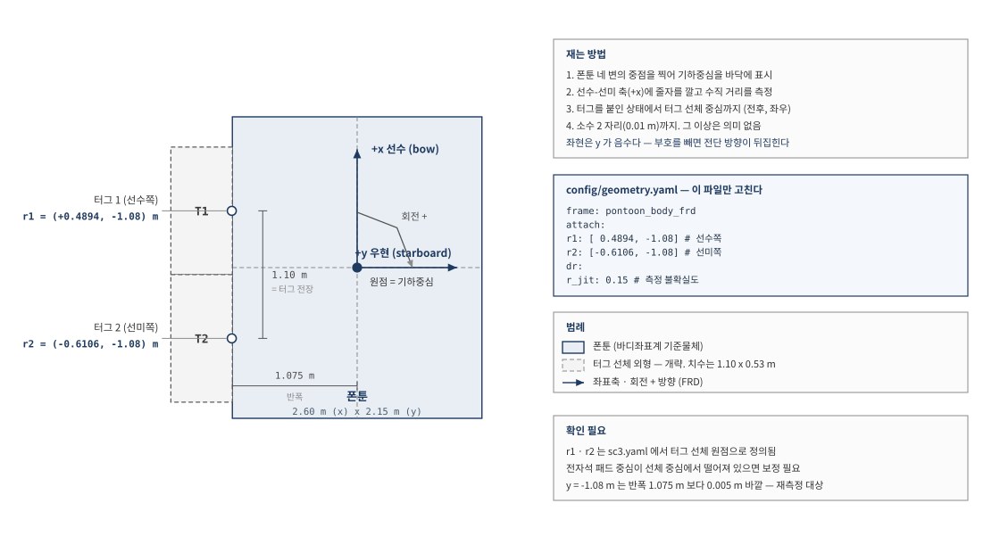

# 부착 기하 — 기준좌표계, 입력 방법, 적용 범위

- 작성: 충남대학교 자율운항시스템공학과 윤원근 교수
- 대상: `config/geometry.yaml` · `nuc/cfg.py` · `tests/test_geometry_cfg.py`

## 1. 개요

- 부착점 `r1` · `r2` 는 터그 2 대가 폰툰에 전자석으로 붙는 자리를 가리킴
- 관측 19 차의 마지막 4 개 성분이며, Latch-aware QP 의 기하행렬을 결정함
- **현장에서 바뀌는 값**이므로 학습 설정(`pontoon_rl/params/sc3.yaml`)에서 떼어
  `config/geometry.yaml` 한 파일로 외부화함
- 이 파일만 고치면 제어기 · QP · 플랜트 · 관측이 한꺼번에 바뀜

| 항목 | 값 |
|---|---|
| 고치는 파일 | `config/geometry.yaml` |
| 병합 지점 | `nuc/cfg.py::load_cfg()` |
| 영향 범위 | `NucController` · `LatchQP` · `PontoonSc3Env`(플랜트) · 관측 `[15:19]` |
| 단위 | m |
| 유효자리 | 소수 2 자리 (0.01 m) |

## 2. 기준좌표계

| 요소 | 정의 |
|---|---|
| 원점 | 폰툰 **기하중심** (`Lx` 2.60 m × `By` 2.15 m 판의 가운데, 균일판 가정의 질량중심) |
| `+x` | 선수 방향 (bow) |
| `+y` | **우현** 방향 (starboard) → 좌현은 음수 |
| 회전 `+` | 위에서 봤을 때 시계방향 |
| 규약 | FRD. `PROTOCOL_esp32_nuc.md` 의 와이어 부호규약 · Fossen 3-DOF 와 동일 |
| 가리키는 점 | **터그 선체 원점**(선체 중심). 전자석 패드 접촉면이 아님 |



*그림 1. 폰툰 바디좌표계와 부착점 정의*

- 터그 2 대가 같은 **좌현 변**에 붙으므로 `r1[1] < 0` · `r2[1] < 0`
- 이 배치가 시나리오 3 의 전제이며, 전단력이 임계가 되는 이유임
  (`pontoon_rl/out/n1/SWEEP_LATCH.md`: 모멘트 수요가 두 터그 전단력의 차로 전가됨)

### 2.1 기본값의 근거

| 성분 | 값 | 근거 |
|---|---|---|
| `r1` | `[ 0.4894, -1.08]` | 선수쪽 터그 |
| `r2` | `[-0.6106, -1.08]` | 선미쪽 터그 |
| `y` | `-1.08` m | 좌현 변. 반폭 `By/2` = 1.075 m |
| `x` 간격 | 1.10 m | `|r1.x − r2.x|` = 터그 전장 `L` = 1.10 m (두 대가 맞닿은 배치) |
| `x` 중점 | `-0.0606` m | 두 터그의 중심이 기하중심보다 6 cm 선미쪽 |

- ⚠️ **확인 필요**: `sc3.yaml` 은 이 값을 `measured(y)`(실측)로 표기했으나, 같은
  파일의 `dr.r_jit` 주석은 "`r_i` 가 불확실한 것이 RL 을 쓰는 이유"라고 적음.
  두 표기가 상충함 → 현장 재측정으로 닫아야 함

## 3. 재는 방법

1. 폰툰 네 변의 중점을 찍어 기하중심을 바닥에 표시
2. 선수–선미 축(`+x`)에 줄자를 깔고, 그 축에 수직인 좌현 거리를 측정
3. 각 터그를 **붙인 상태**에서 터그 선체 중심까지의 (전후, 좌우) 거리를 읽음
   - 선수쪽 → `x` 양수, 선미쪽 → `x` 음수
   - 좌현 → `y` **음수**
4. 소수 2 자리(0.01 m)까지 기록. 그 이상은 의미 없음 (`dr.r_jit` 가 ±0.15 m 흡수)

### 3.1 입력 예

```yaml
frame: pontoon_body_frd
attach:
  r1: [ 0.49, -1.08]
  r2: [-0.61, -1.08]
```

## 4. 적용 확인

| 확인 | 방법 |
|---|---|
| 어떤 기하로 돌았는가 | SITL 머리줄 `부착기하 r1=(…) r2=(…) 간격 … [폰툰 바디 FRD, 원점=기하중심]` |
| 결과 json | `"geometry": "config/geometry.yaml"` 항목 |
| 학습 당시 값으로 되돌리기 | `python sitl/run_sitl.py --geometry off …` |
| 다른 파일 쓰기 | `python sitl/run_sitl.py --geometry config/geometry_v2.yaml …` |

## 5. 입력 검사 (조용한 실패 방지)

| 잘못 | 처리 |
|---|---|
| 오타 (`attatch`, `r3`, `rjit`) | `ValueError: 모르는 항목` — 무시하지 않고 거부 |
| `frame` 변경 | `ValueError` — 좌표계는 코드 전제이므로 yaml 로 바꿀 수 없음 |
| mm 단위 입력 (`[489.4, -1080]`) | `ValueError: … 폰툰(2.60 × 2.15 m) 밖이다` |
| 길이 1·3 벡터 | `ValueError: … 길이가 N 다` |
| `NaN` · `inf` | `ValueError` |
| `dr.r_jit` 범위 밖 | `ValueError` (0–1 m) |
| 파일 없음 | 통과 — `sc3.yaml` 값을 그대로 씀 (기존 동작과 동일) |

## 6. 검증 결과

| 시험 | 기준 | 결과 |
|---|---|---|
| `tests/test_geometry_cfg.py` 9 항 | 전부 통과 | 9/9 PASS |
| 덮어쓰기 끈 값 = `sc3.yaml` | 동일 | 동일 |
| 덮어쓰기 → QP 기하행렬 | 덮어쓴 값과 일치 | 최대차 < 1e-12 |
| 덮어쓰기 → 플랜트 `env.r1/r2` | 덮어쓴 값과 일치 | 최대차 < 1e-12 |
| 원본 설정 불변 | `sc3.yaml` 사전 미변경 | 미변경 |
| 전체 시험 | 0 FAIL | 63 PASS / 0 FAIL |
| SITL 종단시험 (기본 기하) | 1/1 PASS | 간격 1.100 m · `dpos` 0.00104 m |
| SITL 종단시험 (기하 이동) | 1/1 PASS | 간격 1.200 m · `dpos` 0.00727 m |

- 종단시험은 **같은 시드(1000)** 로 두 번 돌린 것임. 기하만 바꿨는데 궤적이 바뀌었으므로
  설정이 **제어기·QP·플랜트까지 실제로 도달**함이 확인됨 (`r1 [0.80, -1.00]` ·
  `r2 [-0.40, -1.00]` 로 이동 → 간격 1.10 → 1.20 m)
- 이동한 기하에서도 **재학습 없이 합격기준(≤ 0.01 m)을 통과**함. 다만 오차가 7 배
  커졌으므로(0.00104 → 0.00727 m) **기하가 크게 바뀌면 재학습이 필요**함
- 재현: `python sitl/run_sitl.py --episodes 1 --dr off --seed0 1000 --geometry <경로>`
  로그 `out/SITL_geomdef.txt` · `out/SITL_geomshift.txt`

## 7. 확인 필요 사항

| 항목 | 현재 설정 | 확인 대상 |
|---|---|---|
| `r1` · `r2` 실측 | `sc3.yaml` 값 (§2.1) | 수조 조립 상태에서 재측정 |
| 실측 불확실도 | `dr.r_jit` 0.15 m | 측정 산포가 0.15 m 를 넘으면 재학습 필요 |
| 가리키는 점 | 터그 선체 원점 | 전자석 패드 중심과의 차이 (패드가 선체 중심에서 떨어져 있으면 보정 필요) |
| 실물 NUC 의 값 출처 | 설정파일 (와이어에 없음) | 52501 · PX4 표준 어느 경로에도 부착점 필드가 없음 — 설정으로만 들어감 |
| 비대칭 배치 | 미시험 | 두 터그가 다른 변에 붙는 배치는 학습 범위 밖 |
